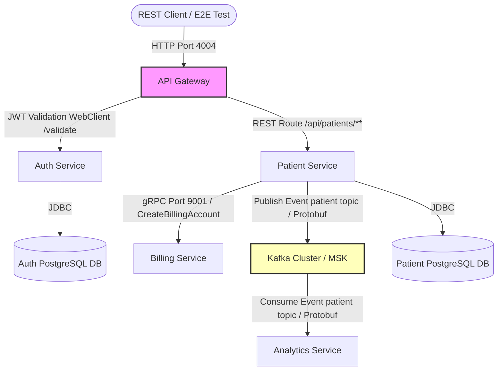

# Patient Management Microservices System

A robust, enterprise-grade patient management system built with Spring Boot microservices, communicating via synchronous REST and gRPC and asynchronous Kafka event streams, packaged and deployed via an AWS CDK Java infrastructure on LocalStack.

---

## Table of Contents

- [System Architecture](#system-architecture)
- [Microservices Overview](#microservices-overview)
  - [API Gateway](#1-api-gateway-api-gateway)
  - [Auth Service](#2-auth-service-auth-service)
  - [Patient Service](#3-patient-service-patient-service)
  - [Billing Service](#4-billing-service-billing-service)
  - [Analytics Service](#5-analytics-service-analytics-service)
- [Infrastructure as Code (AWS CDK)](#infrastructure-as-code-aws-cdk)
- [Getting Started & Local Execution](#getting-started--local-execution)
  - [Prerequisites](#prerequisites)
  - [Building the Services](#building-the-services)
  - [Deploying with LocalStack & CDK](#deploying-with-localstack--cdk)
- [Testing & Validation](#testing--validation)
  - [Integration Tests](#integration-tests)
  - [HTTP Request Collection](#http-request-collection)
- [Technical Architecture Details & Issues](#technical-architecture-details--issues)

---

## System Architecture

The system utilizes a hybrid communication architecture (REST, gRPC, and Kafka) to manage user authentication, patient lifecycle details, billing account creation, and down-stream analytics.



---

## Microservices Overview

All applications are written in **Java 21** using **Spring Boot 3.x**.

### 1. API Gateway (`api-gateway`)
- **Location:** [api-gateway/](file:///C:/Users/SIDDHANT/OneDrive/Desktop/patient-management/api-gateway)
- **Port:** `4004`
- **Main Class:** [ApiGatewayApplication.java](file:///C:/Users/SIDDHANT/OneDrive/Desktop/patient-management/api-gateway/src/main/java/com/example/apigateway/ApiGatewayApplication.java)
- **Configuration:** [application.yml](file:///C:/Users/SIDDHANT/OneDrive/Desktop/patient-management/api-gateway/src/main/resources/application.yml)
- **Description:** A Spring Cloud Gateway (reactive) routing request flows. Routes requests targeting `/auth/**` to the Auth Service and `/api/patients/**` to the Patient Service. It runs a custom filter [JwtValidationGatewayFilterFactory.java](file:///C:/Users/SIDDHANT/OneDrive/Desktop/patient-management/api-gateway/src/main/java/com/example/apigateway/filter/JwtValidationGatewayFilterFactory.java) to check JWT token validity via the Auth Service `/validate` endpoint before forwarding requests to the Patient Service.

### 2. Auth Service (`auth-service`)
- **Location:** [auth-service/](file:///C:/Users/SIDDHANT/OneDrive/Desktop/patient-management/auth-service)
- **Port:** `4005`
- **Main Class:** [AuthServiceApplication.java](file:///C:/Users/SIDDHANT/OneDrive/Desktop/patient-management/auth-service/src/main/java/com/example/authservice/AuthServiceApplication.java)
- **Database:** PostgreSQL (`auth-service-db`)
- **Description:** Handles user creation and JWT authentication. Utilizes Spring Security, Jwts, and BCrypt encoding ([SecurityConfig.java](file:///C:/Users/SIDDHANT/OneDrive/Desktop/patient-management/auth-service/src/main/java/com/example/authservice/config/SecurityConfig.java)). Pre-populates a test admin user via [data.sql](file:///C:/Users/SIDDHANT/OneDrive/Desktop/patient-management/auth-service/src/main/resources/data.sql):
  - **Username/Email:** `testuser@test.com`
  - **Password:** `password123`
  - **Role:** `ADMIN`

### 3. Patient Service (`patient-service`)
- **Location:** [patient-service/](file:///C:/Users/SIDDHANT/OneDrive/Desktop/patient-management/patient-service)
- **Port:** `4000`
- **Main Class:** [PatientServiceApplication.java](file:///C:/Users/SIDDHANT/OneDrive/Desktop/patient-management/patient-service/src/main/java/com/example/PatientServiceApplication.java)
- **Database:** PostgreSQL (`patient-service-db`)
- **Description:** Provides full CRUD endpoints for managing patient records ([PatientController.java](file:///C:/Users/SIDDHANT/OneDrive/Desktop/patient-management/patient-service/src/main/java/com/example/controller/PatientController.java)). Features OpenAPI docs available at `/swagger-ui.html`. 
  - **gRPC Integration:** On patient creation, it issues a synchronous gRPC call using [BillingServiceGrpcClient.java](file:///C:/Users/SIDDHANT/OneDrive/Desktop/patient-management/patient-service/src/main/java/com/example/grpc/BillingServiceGrpcClient.java) to request a billing account.
  - **Kafka Integration:** Broadcasts a Protobuf-serialized `PatientEvent` to the `"patient"` topic using [KafkaProducer.java](file:///C:/Users/SIDDHANT/OneDrive/Desktop/patient-management/patient-service/src/main/java/com/example/kafka/KafkaProducer.java) upon successful patient registration.

### 4. Billing Service (`billing-service`)
- **Location:** [billing-service/](file:///C:/Users/SIDDHANT/OneDrive/Desktop/patient-management/billing-service)
- **HTTP Port:** `4001`
- **gRPC Port:** `9001`
- **Main Class:** [BillingServiceApplication.java](file:///C:/Users/SIDDHANT/OneDrive/Desktop/patient-management/billing-service/src/main/java/com/example/billingservice/BillingServiceApplication.java)
- **Description:** Exposes a gRPC service implementing the protobuf interface defined in [billing_service.proto](file:///C:/Users/SIDDHANT/OneDrive/Desktop/patient-management/billing-service/src/main/proto/billing_service.proto). The service handler [BillingGrpcService.java](file:///C:/Users/SIDDHANT/OneDrive/Desktop/patient-management/billing-service/src/main/java/com/example/billingservice/grpc/BillingGrpcService.java) logs the incoming request and generates a mock billing account (`accountId: "12345"`, `status: "ACTIVE"`).

### 5. Analytics Service (`analytics-service`)
- **Location:** [analytics-service/](file:///C:/Users/SIDDHANT/OneDrive/Desktop/patient-management/analytics-service)
- **Port:** `4002`
- **Main Class:** [AnalyticsServiceApplication.java](file:///C:/Users/SIDDHANT/OneDrive/Desktop/patient-management/analytics-service/src/main/java/com/example/analyticsservice/AnalyticsServiceApplication.java)
- **Description:** Listens for patient events published to the `"patient"` Kafka topic. Uses [KafkaConsumer.java](file:///C:/Users/SIDDHANT/OneDrive/Desktop/patient-management/analytics-service/src/main/java/com/example/analyticsservice/kafka/KafkaConsumer.java) to read incoming byte arrays, deserialize them into `PatientEvent` protobuf instances ([patient_event.proto](file:///C:/Users/SIDDHANT/OneDrive/Desktop/patient-management/analytics-service/src/main/proto/patient_event.proto)), and log the details.

---

## Infrastructure as Code (AWS CDK)

The [infrastructure/](file:///C:/Users/SIDDHANT/OneDrive/Desktop/patient-management/infrastructure) project is a Java-based **AWS CDK** application configured to target a local **LocalStack** instance.

The CDK construct [LocalStack.java](file:///C:/Users/SIDDHANT/OneDrive/Desktop/patient-management/infrastructure/src/main/java/com/example/stack/LocalStack.java) provisions:
- **VPC:** Custom network with private and public subnets.
- **Databases:** RDS PostgreSQL instances for `auth-service` and `patient-service` with credentials loaded from AWS Secrets Manager.
- **Messaging:** Amazon MSK (Managed Streaming for Kafka) cluster.
- **Compute:** ECS Cluster featuring Fargate task definitions for each microservice with automated logging to CloudWatch, health checks, and service dependency ordering.
- **Ingress:** Application Load Balancer mapping HTTP traffic from the outside world into the API Gateway Fargate service.

---

## Getting Started & Local Execution

### Prerequisites
- **Java JDK 21**
- **Apache Maven** (or run using root-level [mvnw](file:///C:/Users/SIDDHANT/OneDrive/Desktop/patient-management/mvnw))
- **Docker** & **LocalStack**
- **AWS CLI** (configured for LocalStack)

### Building the Services
Compile the microservices and generate protobuf classes by running Maven from the root directory:
```bash
# Build all services
mvn clean package
```
*Note: This will trigger the `protobuf-maven-plugin` to generate necessary Java classes from `.proto` files located in the respective services.*

### Deploying with LocalStack & CDK
1. Ensure LocalStack is running on your machine:
   ```bash
   localstack start -d
   ```
2. Navigate to the infrastructure folder, synthesize the CloudFormation template, and run the deployment script:
   ```bash
   cd infrastructure
   ./localstack-deploy.sh
   ```

---

## Testing & Validation

### Integration Tests
The project contains an automated integration test suite in [integration-tests/](file:///C:/Users/SIDDHANT/OneDrive/Desktop/patient-management/integration-tests) using **JUnit 5** and **RestAssured**:
- [AuthIntegrationTest.java](file:///C:/Users/SIDDHANT/OneDrive/Desktop/patient-management/integration-tests/src/test/java/AuthIntegrationTest.java): Tests login flows, verifies response tokens, and checks unauthorized states.
- [PatientIntegrationTest.java](file:///C:/Users/SIDDHANT/OneDrive/Desktop/patient-management/integration-tests/src/test/java/PatientIntegrationTest.java): Generates an auth token, makes a request to `/api/patients`, and asserts that the API Gateway validates the token correctly.

Run these tests via:
```bash
cd integration-tests
mvn test
```

### HTTP Request Collection
You can use IntelliJ's built-in HTTP client or similar tools to manually test endpoints.
- **Auth REST:**
  - Login Request: [login.http](file:///C:/Users/SIDDHANT/OneDrive/Desktop/patient-management/api-requests/auth-service/login.http)
  - Validate Request: [validate.http](file:///C:/Users/SIDDHANT/OneDrive/Desktop/patient-management/api-requests/auth-service/validate.http)
- **Patient REST:**
  - Get Patients: [get-patients.http](file:///C:/Users/SIDDHANT/OneDrive/Desktop/patient-management/api-requests/patient-service/get-patients.http)
  - Create Patient: [create-patient.http](file:///C:/Users/SIDDHANT/OneDrive/Desktop/patient-management/api-requests/patient-service/create-patient.http)
  - Update Patient: [update-patient.http](file:///C:/Users/SIDDHANT/OneDrive/Desktop/patient-management/api-requests/patient-service/update-patient.http)
  - Delete Patient: [delete-patient.http](file:///C:/Users/SIDDHANT/OneDrive/Desktop/patient-management/api-requests/patient-service/delete-patient.http)
- **Billing gRPC:**
  - Create Billing Account: [create-billing-account.http](file:///C:/Users/SIDDHANT/OneDrive/Desktop/patient-management/grpc-requests/create-billing-account.http)

---

